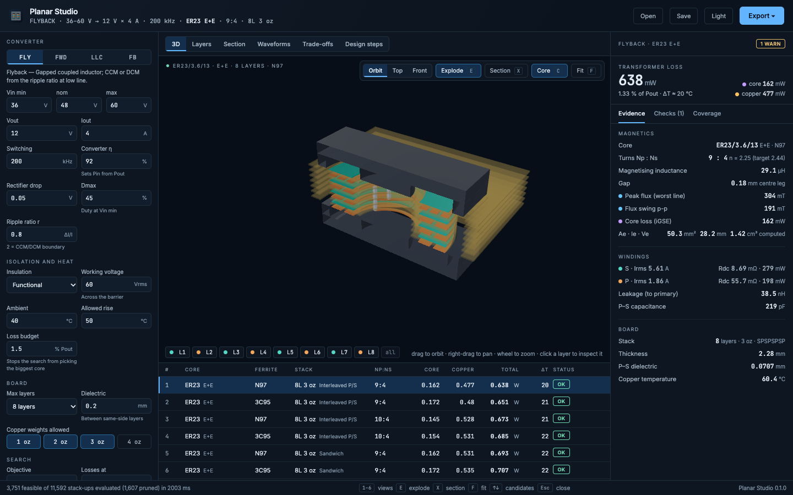
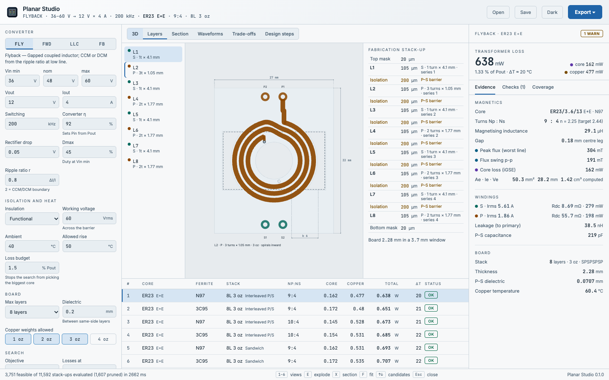

# Planar Studio

Design a planar transformer on a multilayer PCB. Give it the converter —
topology, Vin, Vout, Iout, switching frequency, isolation class — and it
searches cores × ferrites × turns × layer counts × copper weights × layer
arrangements, ranks every design that passes, and shows the winner:

- **3D** — ferrite halves, the PCB stack with every copper layer, junction vias
  and terminals. Explode, section cut, top/front views, click a layer to inspect it.
- **Layers** — each copper layer drawn to scale with dimensions, plus the
  fabrication stack-up (copper, dielectric, the P–S isolation barriers).
- **Section** — the window cross-section with the MMF across the stack, and
  the copper loss of every layer.
- **Waveforms** — winding currents, centre-leg flux and primary voltage.
- **Trade-offs** — best loss per core, loss against turns, AC factor per layer.
- **Design steps** — the design path: each formula with the numbers put in.

Exports: a **KiCad project** (board with the real stack-up, every turn as a
filled copper zone on its net, blind/buried vias, cut-outs, and a `.kicad_pro`
holding the fab rules), **Gerber + Excellon** (copper per layer, outline,
PTH and per-span blind/buried drills), **DXF**, and an **HTML report** that
prints to PDF. Designs save and reopen as `.planar.json`.




## Run it

Double-click **Planar Studio** in App Launcher, or `~/Desktop/Apps/Planar Studio.command`.
It opens in the browser; a second double-click reuses the running copy.

After changing the code, reinstall (the shortcuts run the installed copy):

```bash
./install.sh
```

**Windows:** copy the repo, install Node 22.18+ from nodejs.org, double-click
`run-planar-studio.bat` (the first start builds the interface). This launcher
has **not been run on Windows** — the code avoids anything macOS-specific
(paths through `node:path`, downloads through the browser), but it is untested
there.

## Topologies

| | Transformer | Turns ratio | Inductance |
|---|---|---|---|
| Flyback | gapped coupled inductor, CCM/DCM | from Dmax at Vin min | from the ripple ratio |
| Forward | ungapped, unipolar flux | from Dmax at Vin min | what the core gives |
| LLC half-bridge | at resonance, centre tap or full bridge | unity gain at Vin nom | Lm for ZVS from tdead and Coss |
| Full bridge | ungapped, bipolar, hard-switched | from Dmax at Vin min | what the core gives |

## How the numbers are made

- **Core loss:** iGSE on the actual flux waveform, Steinmetz parameters at 100 °C.
- **Copper loss:** 1-D Dowell/Ferreira per layer and per harmonic (21), with
  porosity, MMF referenced to the gap plane — interleaving shows up directly.
- **Gap:** McLyman fringing factor, solved for the target Lm.
- **Leakage and P–S capacitance:** from the same MMF profile and stack.
- **Isolation:** P–S dielectric from test voltage and DTI; creepage via the
  (conductive) ferrite sets the outer-layer keep-back and the terminal distance.
- **Thermal:** natural convection on the core plus part of the board.

Every formula has a test against an independent route to the same number
(`tests/physics.test.ts`): Dowell against a finite-difference field solution,
iGSE against its closed forms, leakage against the analytic two-layer result,
flux from currents against volt-seconds, energy balance of the waveforms.

## Tests

```bash
npm test
```

```bash
npm run test:e2e
```

`npm test` — 44 core tests, including KiCad's own DRC on six generated boards
(zero violations, zero unconnected items) when KiCad is installed.
`npm run test:e2e` — Playwright drives the real UI in both themes: every view,
every topology, every export (the downloaded KiCad project is DRC-checked
again), save/reopen, bad input, an impossible spec, keyboard, axe, and the
fold probe at 1366×768 and 1440×900.

## Limitations

- **Windows launcher untested on Windows** (written, never run there).
- **Core catalogue** (`shared/library.json`) was checked against the vendor
  datasheets on 2026-11-01: E/ELP cores use TDK's ELP sheets (Ae, le, Ve and
  Amin for both E+E and E+plate), ER cores Ferroxcube's (sold as pairs only).
  Sources are listed in the file. Saturation is checked in Amin.
- **Ferrite loss** comes from the typical loss points of each material sheet at
  100 °C, with the Steinmetz α taken locally at fsw. Typical means typical: the
  guaranteed maximum per set is 1.5–3.5× higher. 3C95 and 3F36 publish one
  frequency only, so their frequency slope is borrowed (from N97 and N49);
  N87/N97/3C95 use β = 2.5, the usual MnZn value, because their sheets give no
  two flux levels at one frequency.
- **Winding model is 1-D**: no end-turn, jog or lead effects; parallel layers
  are assumed to share current equally; the extra loss next to a gap from the
  2-D fringing field is not included; via and termination resistance ignored.
- **Thermal** is a one-number natural-convection estimate.
- **Isolation** checks are screening rules, not a certification; inner-layer
  edge distances (cemented joints) are not checked.
- **LLC** is evaluated at resonance only; the resonant tank is not designed.
  **Full bridge** uses a hard-switched waveform (no phase-shift circulating current).
  **Forward** reset winding/clamp and output inductors are not designed.
- **Via ring:** an inward spiral's junction via sits on a ring inside the
  innermost turn, which costs that ring's width on every layer (a local
  pocket at the front would not).
- **KiCad export is a board, not a footprint** — copy it into a main board or
  use it as a design block. Gerbers are checked for structure and the ZIP with
  `unzip -t`, but have not been opened in a Gerber viewer here; the KiCad
  board, which shares the geometry, passes KiCad DRC. The DXF has not been
  opened in a CAD tool.
- The report becomes a PDF through the browser's print dialog.

See `TODO.md` for what is next and `ARCHITECTURE.md` for how to extend it.
